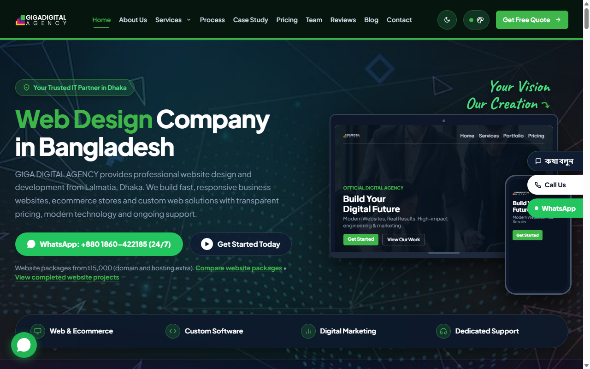
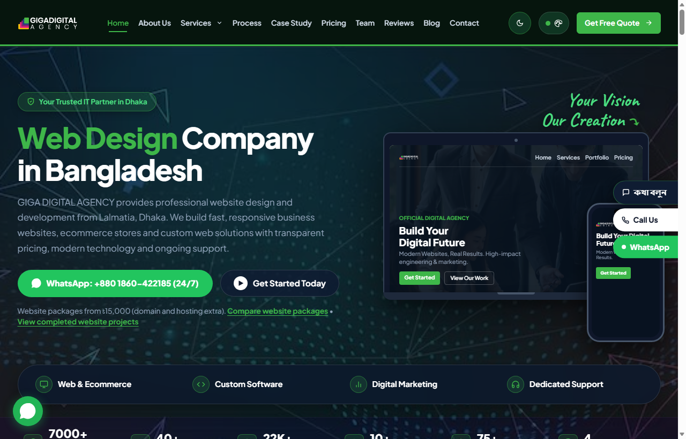
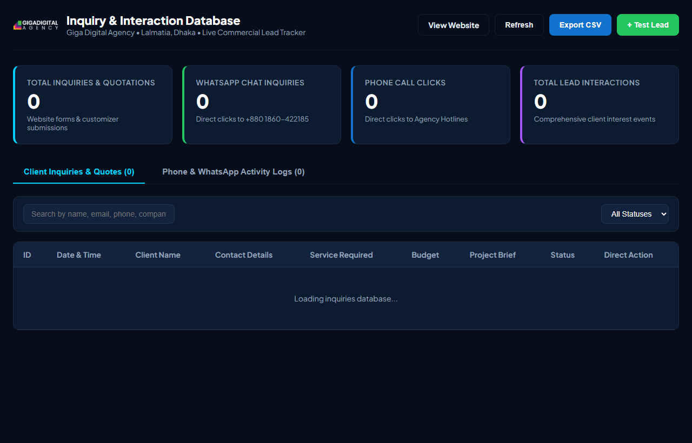
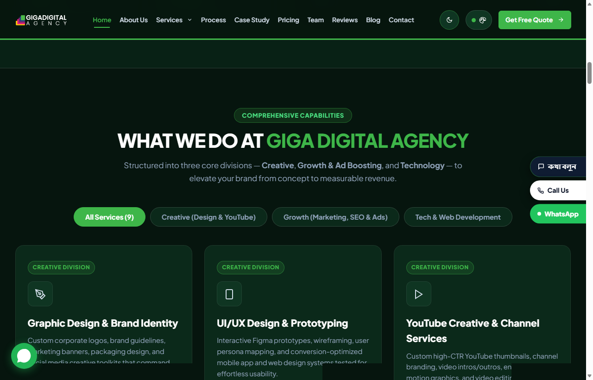
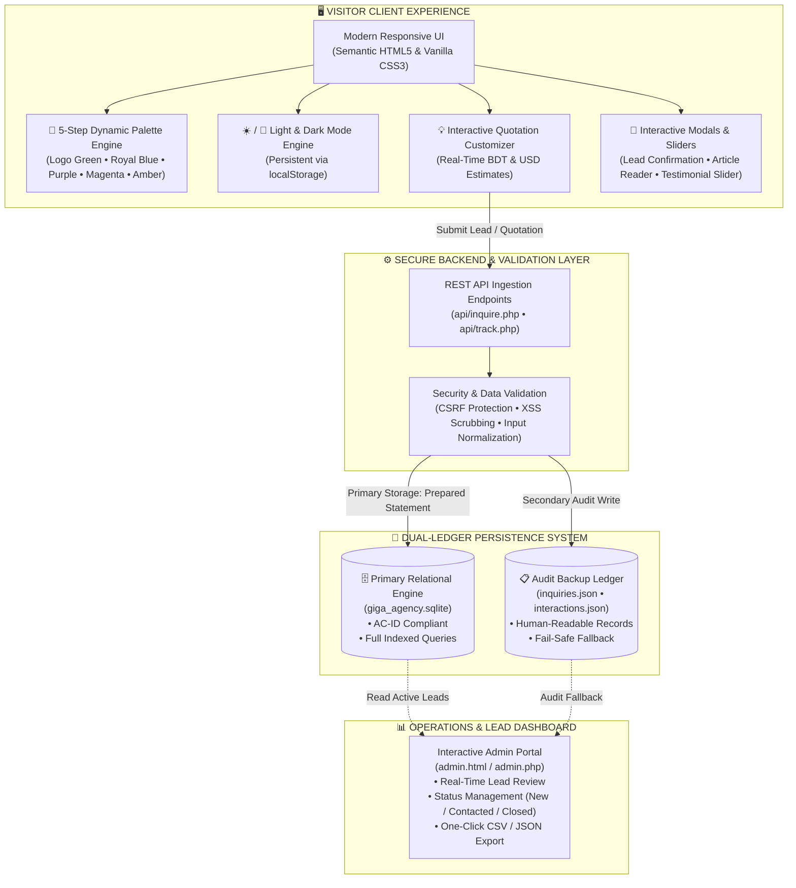
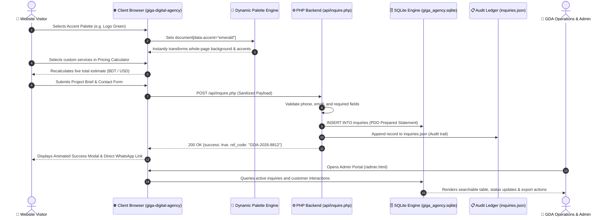
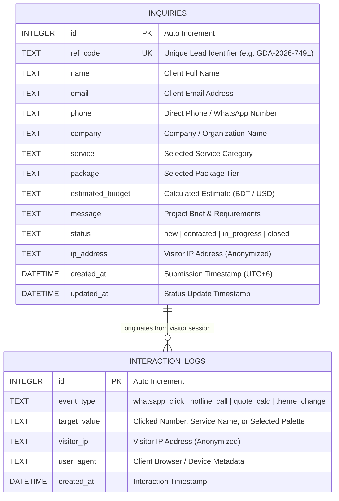

# Giga Digital Agency — Official Website Platform

[](https://giga-digital-agency.vercel.app/)
[](https://www.php.net/)
[](https://www.sqlite.org/)
[](https://giga-digital-agency.vercel.app/)
[](https://giga-digital-agency.vercel.app/)
[](https://giga-digital-agency.vercel.app/)

This repository contains the complete custom-designed, enterprise-grade, responsive website platform for **Giga Digital Agency** (GDA) — Dhaka, Bangladesh.

Designed with an international digital creative & growth agency aesthetic, this platform features an atmospheric solid canvas, a **5-step dynamic brand palette switcher**, instant light/dark mode persistence, a transparent frosted-glass navigation header, prominent high-resolution branding, interactive package quotation customizer, real-time dual-ledger lead persistence (SQLite 3 + JSON audit logs), and an interactive admin dashboard.

---

## 📸 Website Visual Showcase & Interactive Transitions

Visitors experience smooth, dynamic visual transitions across color palettes and light/dark modes as they interact with the platform:

### 1. Dynamic Atmosphere & Palette Transitions

| Default Dark Mode (Tech Sapphire) | Logo Green Atmosphere (Obsidian Emerald) |
| :---: | :---: |
|  |  |
| *Signature midnight slate canvas with Royal Blue accents* | *Dynamic whole-page canvas shift to deep obsidian emerald* |

| Crisp Light Mode (Nordic Slate) | Real-Time Admin Operations Portal |
| :---: | :---: |
|  |  |
| *Instant light mode transition with soft pastel contrasts* | *Live lead review, search filter & status management* |

### 2. Categorized Services & Engineering Deck


*Interactive multi-division service showcase covering Creative Design, Performance Marketing & E-Commerce Engineering.*

---

## 🗺️ System Architecture & Visual Overview



---

## 🔄 User Lead & Interactive Quotation Journey



---

## 🗄️ Database Entity-Relationship (ER) Model



---

## 🎨 5-Step Official Logo Palette Matrix

The website's atmosphere transforms dynamically based on the 5 signature steps of the official Giga brand identity:

| Step | Swatch | Palette Name | Accent Hex | Dark Mode Atmosphere | Light Mode Atmosphere |
| :---: | :---: | :--- | :--- | :--- | :--- |
| **01** | 🟢 | **Logo Green** | `#3eb649` | Deep Obsidian Emerald (`#06150e` / `#071c12`) | Soft Mint Porcelain (`#f0faf3` / `#e6f6ec`) |
| **02** | 🔵 | **Logo Royal Blue** | `#1d4ed8` | Tech Midnight Sapphire (`#071324` / `#08162a`) | Crisp Nordic Slate (`#f1f6fb` / `#e7f0fa`) |
| **03** | 🟣 | **Logo Purple** | `#7c3aed` | Deep Cosmic Amethyst (`#100a20` / `#140d27`) | Soft Lavender Mist (`#f5f2fa` / `#ece6f6`) |
| **04** | 🔴 | **Logo Magenta** | `#e11d48` | Rich Velvet Wine (`#180812` / `#1d0a16`) | Delicate Rose Glaze (`#faf1f4` / `#f8e8ed`) |
| **05** | 🟡 | **Logo Amber** | `#f59e0b` | Warm Espresso Amber (`#161005` / `#1b1407`) | Sunlit Sandstone (`#faf6f0` / `#f6ede0`) |

---

## 📁 Repository Directory Layout

```
giga-digital-agency/
├── 📄 index.html                 # Production static entrypoint (11 services, 6-step process, 3-tier pricing, FAQ)
├── 📄 index.php                  # Dynamic PHP entrypoint with component architecture
├── 📄 admin.html                 # Client-side Admin Portal & lead review dashboard
├── 📄 admin.php                  # Server-side PHP Admin Portal with live database queries
├── 📁 services/                  # 11 Dedicated High-Conversion Service Detail Pages
│   ├── 📄 linkedin-ads.html      # LinkedIn Ads Management detail page
│   ├── 📄 google-ads.html        # Google Ads Management detail page
│   ├── 📄 facebook-boosting.html # Facebook Boosting Service detail page
│   ├── 📄 seo.html               # Search Engine Optimization (SEO) detail page
│   ├── 📄 digital-marketing.html # Digital Marketing Multi-Channel detail page
│   ├── 📄 company-profile-design.html # Company Profile & Brochure Design page
│   ├── 📄 banner-poster-design.html   # Banner & Poster Creative Design page
│   ├── 📄 content-marketing.html      # Content Marketing & Storytelling page
│   ├── 📄 branding-design.html        # Branding, Logo & Visual Identity page
│   ├── 📄 video-editing.html          # Professional Video Editing page
│   └── 📄 web-design-development.html # Web Design & Development detail page
├── 📁 api/                       # REST endpoints & form ingestion handlers
│   ├── 📄 inquire.php            # Quotation & project brief handler (PDO + JSON)
│   └── 📄 track.php              # Real-time interaction logger (hotline/WhatsApp clicks)
├── 📁 database/                  # Dual-ledger database engine & schema definitions
│   ├── 📄 schema.sql             # Clean, human-readable SQL definitions & sample data
│   ├── 📄 giga_agency.sql        # Standard SQL export for MySQL / MariaDB / SQLite
│   ├── 💾 giga_agency.sqlite     # Active compiled SQLite 3 runtime database
│   ├── 📋 inquiries.json         # Real-time JSON audit ledger for all customer submissions
│   ├── 📋 interactions.json      # Real-time JSON log for visitor click interactions
│   ├── 📄 db.php                 # PHP PDO singleton connection & dual-storage handler
│   ├── 📄 README.md              # Database documentation & inspection guide
│   └── 🔒 .htaccess              # Direct web browser access blocker for database files
├── 📁 includes/                  # Modular PHP components
│   ├── 📄 header.php             # Frosted glass navigation, logo & palette switcher
│   └── 📄 footer.php             # 4-pillar banner, corporate footer & dynamic modals
├── 📁 css/                       # Master stylesheet
│   └── 📄 style.css              # 3,400+ lines of custom CSS variables, themes & components
├── 📁 js/                        # Client-side interactivity
│   └── 📄 main.js                # Theme switcher, FAQ accordion, package switcher & modals
├── 📁 images/                    # Brand assets, project mockups & client showcases
└── 📄 README.md                  # Master documentation with visual architecture diagrams
```

---

## 🏢 Project Specifications & Verified Identity

* **Official Brand:** Giga Digital Agency (GDA) — Est. 2014
* **Brand Tagline:** "Your Growth. Our Digital Strategy."
* **Positioning:** A professional, results-driven digital marketing and creative solutions agency helping businesses establish a strong online presence, reach their target audiences, generate qualified leads, and achieve sustainable growth.
* **11 Core Specialized Disciplines:**
  * **Growth & Advertising:** LinkedIn Ads Management, Google Ads Management, Facebook Boosting Service, Search Engine Optimization (SEO), Digital Marketing.
  * **Creative & Content:** Company Profile & Business Profile Design, Banner & Poster Design, Content Marketing, Branding & Design, Professional Video Editing.
  * **Web & Technology:** Web Design & Development, Custom Enterprise Solutions.
* **Headquarters:** House # 6/14, Block # A, Lalmatia, Dhaka-1207, Bangladesh *(additional operations: Mirpur / Shewrapara, Dhaka)*.
* **Office Hours:** Saturday – Thursday, 9:30 AM – 7:00 PM (GMT+6)
* **Direct Hotlines:** `+8801870-699677`, `+8801870-699677`
* **Direct WhatsApp:** `+8801870-699677` (Instant Click-to-Chat enabled)
* **Official Emails:** `info@gigadigitalagency.com`, `supports@gigadigitalagency.com`
* **Live Deployment:** [https://giga-digital-agency.vercel.app/](https://giga-digital-agency.vercel.app/)
* **GitHub Repository:** [https://github.com/snigdhaurmiurma/giga-digital-agency.git](https://github.com/snigdhaurmiurma/giga-digital-agency.git)
* **Core Team & Leadership:**
  * **Engr. Md. Ashikur Rahman** — Founder & CEO
  * **Engr. Md. Hasinur Rahman** — CTO (Chief Technology Officer)
  * **Engr. Md. Al Amin** — Senior Software Engineer
  * **Jannatul Nayem** — Digital Marketing Specialist
  * **Engr. Md. Mehedi Hasan** — Senior Graphics Designer
  * **Md. Rezaul Karim** — Deputy General Manager
  * **Md. Nazmus Sakib** — Digital Marketing Specialist
  * **Kobir Hossen** — App Developer
* **Accreditations & Awards:**
  * **2016:** Site of the Day / National ICT Ecosystem Recognition (Accreditation Reg: `GDA-ICT-BD-2016`)
  * **Track Record:** 80+ Citations, 7,000+ Completed Deliverables, 98.4% Retention Rate.

---

## 🚀 How to Run in VS Code

### Instant Frontend Preview
1. Open the project folder in **Visual Studio Code**.
2. Right-click `index.html` and select **"Open with Live Server"**.
3. The platform will launch in your browser at `http://127.0.0.1:5500/index.html`.

### Running Dynamic PHP Edition
1. Open the integrated terminal in VS Code (`Ctrl + ~`).
2. Run:
   ```bash
   php -S localhost:8000
   ```
3. Visit `http://localhost:8000` to test the dynamic PHP version, API endpoints, and live database writes.

### Inspecting the Database in VS Code
* **To read the SQL tables as text:** Open [`database/schema.sql`](file:///database/schema.sql).
* **To inspect customer submissions as text:** Open [`database/inquiries.json`](file:///database/inquiries.json).
* **To view the compiled SQLite database visually:** Install the VS Code extension **"SQLite Viewer"** (by Florian Klampfer), then click on [`database/giga_agency.sqlite`](file:///database/giga_agency.sqlite) to view live tables in a spreadsheet interface.
* **To view via web dashboard:** Visit `http://localhost:8000/admin.html` or `http://localhost:8000/admin.php`.

---

## 🌐 Production Deployments
* **Live Website:** [https://giga-digital-agency.vercel.app/](https://giga-digital-agency.vercel.app/)
* **GitHub Repository:** [https://github.com/snigdhaurmiurma/giga-digital-agency.git](https://github.com/snigdhaurmiurma/giga-digital-agency.git)
