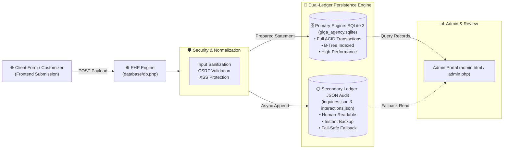
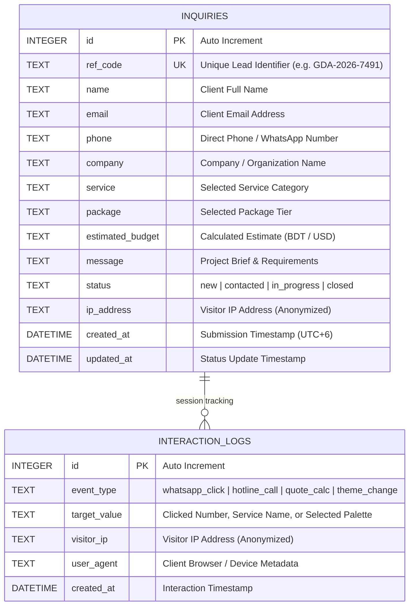

# Giga Digital Agency — Database & Lead Capture Architecture

This directory houses the persistent relational database engine and dual-ledger storage system for **Giga Digital Agency** (GDA).

---

## 📊 Dual-Storage Pipeline & Data Flow

---

## 🗄️ Entity-Relationship (ER) Diagram

---

## 📁 Files in this Directory

| File | Purpose | Format | How to Inspect |
| :--- | :--- | :--- | :--- |
| **`schema.sql`** / **`giga_agency.sql`** | Complete DDL schema, table structures, indexes, and initial records. | Plain SQL text | Click to view directly in VS Code with syntax highlighting. |
| **`giga_agency.sqlite`** | Active, compiled binary database file used at runtime by PHP PDO. | Binary SQLite 3 | Install **"SQLite Viewer"** extension in VS Code to view as an interactive spreadsheet. |
| **`inquiries.json`** | Real-time JSON backup ledger for all customer quotations, briefs, and inquiries. | JSON text | Click to view in VS Code as formatted, human-readable text. |
| **`interactions.json`** | Real-time JSON log for visitor clicks (WhatsApp, hotline, calculator). | JSON text | Click to view in VS Code as formatted, human-readable text. |
| **`db.php`** | PHP PDO connection handler, prepared statements, and dual-ledger writer. | PHP 8 | Standard PHP code file. |
| **`.htaccess`** | Production server security rule blocking direct public web access to database files. | Apache config | Standard configuration file. |

---

## 🔍 How to Inspect the Database in VS Code

1. **Why does clicking `giga_agency.sqlite` say "Binary File"?**
   * SQLite is a compiled binary database format (the exact same engine used in production systems and mobile apps worldwide). A text editor cannot display raw compiled binary bytes as text.
2. **How to view the database visually inside VS Code:**
   * Open the Extensions tab in VS Code (`Ctrl + Shift + X`).
   * Search for **"SQLite Viewer"** (by *Florian Klampfer*).
   * Click **Install**.
   * Now click on `giga_agency.sqlite` in your sidebar: it will open in an interactive spreadsheet view with searchable rows and columns!
3. **How to view SQL tables as text:**
   * Open `schema.sql` to view the full schema, table columns, constraints, and sample data.
4. **How to view leads via web browser:**
   * Open `admin.html` in your browser (or visit `http://localhost:8000/admin.php` when running PHP) to view the interactive management dashboard with search and CSV export.
